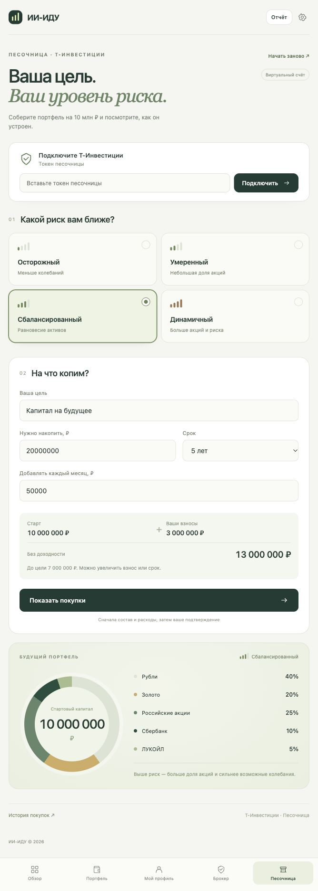

# ИИ-ИДУ

Портфель под цель: четыре уровня риска, понятный состав и покупки в песочнице Т-Инвестиций. Реальный брокерский счёт доступен для просмотра и аналитики.

Python 3.10+, SQLite и обычные HTML/CSS/JavaScript. Без сторонних Python-пакетов и сборки фронтенда.

## Быстрый запуск

```sh
git clone https://github.com/pafimov/ii-idu.git
cd ii-idu
python3 mvp/app.py
```

Откройте **[песочницу](http://127.0.0.1:8765/#sandbox)**. Для раздела не нужна регистрация: при первом входе создаётся демоаккаунт.

1. Вставьте sandbox token Т-Инвестиций.
2. Выберите риск: осторожный, умеренный, сбалансированный или динамичный. Денежный рынок TMON занимает 85%, 60%, 40% или 10% соответственно.
3. Укажите цель, сумму, срок и ежемесячный взнос. Диаграмма сразу покажет доли.
4. Нажмите «Показать покупки»: появятся бумаги, количества, лимитные цены и комиссия.
5. Подтвердите показанный план. Доступные бумаги покупаются сразу, закрытые — автоматически по открытии до указанного срока с теми же лимитами и количествами.
6. «Начать заново» создаст чистый виртуальный счёт с 10 млн ₽, сохранив прежнюю историю.

Токен выпускается по [инструкции Т-Инвестиций](https://developer.tbank.ru/invest/intro/intro/token) и вводится в интерфейсе. База создаётся при запуске и не входит в репозиторий.



## Что внутри

- [Инструкция и устройство приложения](mvp/README.md)
- [Архитектура и границы модулей](mvp/docs/ARCHITECTURE.md)
- [Пользовательский путь](mvp/docs/CJM.md)
- [Сценарий показа 17 октября](mvp/docs/DEMO.md)
- [Соответствие требованиям](mvp/docs/REQUIREMENTS.md)
- [Проверки](mvp/docs/VERIFICATION.md)
- [PRD, SRS, User Stories и RTM](output/requirements/)

Детерминированные правила отделены от HTTP, хранения и брокерского адаптера. Подтверждение связано с точным предложением; UUID сохраняется до отправки, неизвестный исход блокирует повтор, позиции сверяются с исполнениями.

Торговые вызовы направлены только в sandbox. Промышленная интеграция, публичный вход и эксплуатационные требования описаны в карте готовности.

## Проверки

```sh
python3 -m unittest discover -s mvp -v
```

Для проверки JavaScript нужен Node.js:

```sh
node --check mvp/static/app.js
node --check mvp/static/broker.js
node --check mvp/static/sandbox.js
```

Также доступны `make run`, `make test`, `make check`, `make package`. Тесты используют отдельные базы и вымышленные ответы брокера; брокерский токен не требуется.


## Материалы для демо

- [Полное техническое описание, схема и вопросы](mvp/docs/DEMO_BRIEF.md).
- [Готовый рассказ на две минуты](mvp/docs/DEMO_SPEECH.md).
