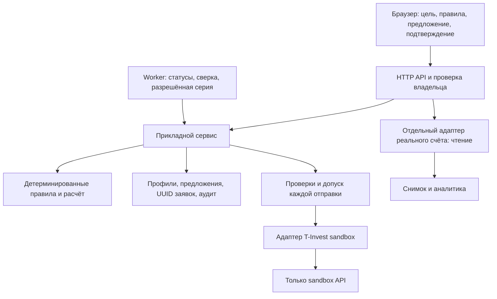

# Целевая архитектура и реализованный срез

## Обновление 0.4.0: отдельная demo-конфигурация

D-010 меняет sandbox UI: четыре условных уровня риска и простая цель вместо полного профиля. `validate_demo_config` принимает только strategy_id, goal_name, target_amount, horizon_years, monthly_contribution. `make_demo_policy` фиксирует mode=demo, config/version, weights и sandbox_last_close. Несуществующие ответы опыта/риска/долгов не подставляются; полный профиль и реальный read-only контур сохраняются отдельно.

`demo-preview` рассчитывает в памяти и атомарно сохраняет config/policy/proposal только при неизменных исходных версиях и ledger. Ошибка оставляет прежнее согласие действующим. Финальный execute связывает точные config, policy и заявки с hashed proposal; отдельные Apply/Resume в demo не требуются. Изменение карточки/цели в браузере не вызывает отправку. Backend Stop и финальный допуск каждой отправки сохранены; в UI показывается однократная подтверждённая серия.

`reset-demo` с UUID action key блокирует активные/неизвестные заявки и незавершённое создание/пополнение, отзывает неотправленное и открывает новый счёт10млн. Прежний счёт, позиции и аудит не удаляются. Успешный повтор key, в том числе после restart, не повторяет внешние операции. Неизвестный результат не ретраится автоматически. Незавершённые action statuses блокируют весь путь от preview до final send gate. Refresh публикуется только при точном совпадении исходных account+version; поздний ответ или ошибка старого счёта не восстанавливают его после reset.

`public_state.snapshot_reconciled` сравнивает UID/количество с baseline последнего подтверждённого proposal и исполнениями ledger. Scope этой сверки — количества позиций; cash показан из последнего брокерского снимка, денежный settlement ledger не моделируется. Timestamp не используется как доказательство свежести snapshot: несколько изменений могут попадать в одну секунду. UI ждёт bool=true для финального экрана. Worker делает ограниченные быстрые повторные сверки после filled; завершённый demo proposal автоматически не заменяет.

Подтверждены132 программных теста и browser/FakeSandbox цикл покупки/нового старта, 360px. Четыре риска — фиксированные demo-корзины, не approved модель индивидуальной пригодности реального клиента. Целевые production gates и SRS ниже остаются в силе. Дальнейшая схема описывает общую архитектуру, исторический профильный API сохранён для совместимости.

Срез: 16.10.2026. Код построен как **модульный монолит на Python**: доменные правила, прикладной сценарий, учёт, временные подключения и брокерские адаптеры разделены. Текущая поставка выполняет цикл в T-Invest sandbox; для реального счёта доступны просмотр и аналитика.

Основание — все четыре актуальных документа PRD/SRS/US/RTM от 12.10.2026: 13 FR, 8 NFR, 55 критериев и 66 вариантов проверок. Точная карта реализации и пробелов — [REQUIREMENTS.md](REQUIREMENTS.md). Целевая модель внешнего продукта и D-003/D-005/D-006 сохранены.

## Схема

LLM может появиться над профилем и объяснениями, но не получает токен, права отправки и возможности менять числа допуска.

## Ответственность модулей

| Модуль | Реализованная ответственность | Переход к целевому контуру |
|---|---|---|
| `app.py` | HTTP, аккаунты, сессии, проверка Origin/Host, маршруты | Public transport за HTTPS, T-ID/delegated consent, отдельные роли; прикладной сценарий переиспользуется |
| `engine.py` | Валидация профиля/портфеля, расчёт аналитики | Развитие domain model без привязки к браузеру/брокеру |
| `portfolio_policy.py` | Доступность трёх стратегий, версии правил, резерв, целевые веса, целые лоты, отклонения, арифметика цели | Утверждённые suitability, universe, risk buckets, benchmarks и расходы |
| `broker_gateway.py` | Контракт операций, который используют сервис и тестовый gateway | Отдельный согласованный production adapter; реальные торговые методы в read-only adapter не добавляются |
| `sandbox_service.py` | Подключение, отдельный профиль, правила, предложение, согласие, gate, worker, сверка, остановка | Выделяемые application services; production scheduler с leases и наблюдаемостью |
| `sandbox_store.py` | Транзакции SQLite, состояния, предложения, intents, actions и audit | Репозиторий PostgreSQL, миграции, ограничения/индексы, защищённое audit storage и retention |
| `sandbox.py` | Фиксированный sandbox host, allowlist, каталог, котировки, комиссии, лимитные заявки, статусы/отмена | Contract tests нового adapter с platform owner; sandbox не переключается в production настройкой |
| `tinvest.py` | RUB/long read-only портфель, НКД, сверка типов и количеств | Отдельный data contract и допустимый universe |
| `broker_sessions.py` | Два раздельных RAM vault с owner/session binding; sandbox — до отключения/выхода/завершения процесса, read-only — idle 30 мин / max 8 ч | Утверждённые entitlement/revocation и secret-management contract |
| `static/` | Формы и отображение подтверждённых состояний | UI не является источником торговых полномочий |

Один процесс и SQLite выбраны для понятного запуска и проверки инвариантов. Разделение по ответственности позволяет заменить transport, repository и broker adapter отдельно. Микросервисы пока добавили бы эксплуатацию без подтверждённой потребности.

## Поток решения и исполнения

1. Подтверждённый профиль песочницы получает версию. Начало пересмотра отзывает неотправленное. Основной профиль пользователя меняется только своим явным действием.
2. Выбор стратегии создаёт черновик правил. Отдельное применение фиксирует счёт, профиль, веса/лимиты, рублёвый резерв, порог ребалансировки, срок 30 дней и режим котировки.
3. Предложение фиксирует исходный снимок, версии, точные инструменты, направления, лоты/штуки, лимитные цены, комиссию, запас бюджета и срок 10 минут. SHA-256 проверяется при подтверждении и перед отправкой; это прикладной контроль целостности, не цифровая подпись клиента.
4. Подтверждение относится только к показанному предложению. До HTTP POST в транзакции записываются UUID, payload и submitting. Ledger сверяется с точными параметрами подтверждённого предложения, а не только с его ID.
5. Перед каждым POST повторяются pre-trade проверки и финальная проверка сессии/подключения, версий, срока, stop, согласия и согласованности счёта. Финальный permit и stop сериализованы. Сеть выполняется вне SQLite write transaction.
6. NEW означает принятие. Filled и частичный объём берутся из ответа/статуса брокера; терминальные состояния не откатываются. Следующая заявка серии ждёт подтверждённого исполнения предыдущей.
7. Неизвестный исход сохраняет исходный UUID и блокирует новые заявки. Worker читает статус по Request ID; автоматического повторного POST нет.
8. Снимок сверяется с исходными позициями и подтверждёнными исполненными количествами. Отстающий или противоречивый ответ сохраняет прежний снимок и закрывает новые отправки.

Создание и пополнение также имеют durable action key. Ожидается ровно 10 млн виртуальных рублей; неизвестный исход открытия/пополнения не повторяется автоматически.

## Остановка, отключение и восстановление

«Стоп» сначала сохраняет запрет новых permits и отзывает неотправленные части серии. Кнопка работает во время ожидания сети. Запрос, уже получивший permit, может завершиться; его результат сохраняется в ledger. Отмена активного остатка выполняется отдельно и подтверждается брокером. Отключение/TTL/выход не подменяют отмену заявки.

Блокировка vault действует на одно подключение, поэтому медленный POST не блокирует чтение состояния другого владельца. Поздние ответы не публикуют старый профиль, политику или снимок. Учёт допущенной отправки, напротив, сохраняется и после stop/logout.

После перезапуска секрет отсутствует, но UUID, события и stop сохраняются. Для продолжения нужны повторное подключение и сверка. Worker сейчас один на процесс; persisted leases, отказоустойчивые очереди и полноценный DR относятся к следующему эксплуатационному контуру.

## Свежесть, данные и полномочия

`strict_30s` допускает котировку возрастом до 30 секунд. Отдельная `sandbox_last_close` допускает последнюю сессию только в песочнице; режим записывается в правила и согласие. Фактическая серия 16.10.2026 использовала `strict_30s`.

Время получения портфеля `fetched_at` не доказывает время актуальности денег/позиций у источника. Для production NFR-2 нужны timestamp/sequence и контракт брокера: 60 секунд для денег/позиций/поручений, 30 секунд для цены. Sandbox-проверка не закрывает этот gate.

Токены не входят в БД, audit, public state, отчёты и архив. Sandbox host фиксирован; proxy/redirect и fallback в production запрещены. Реальный read-only adapter не экспортирует submit/cancel. Права sandbox token проверяются сервером брокера, а не угадываются по строке токена.

Audit добавляется событиями и доступен владельцу. Прямое редактирование/удаление через API отсутствует, но административный доступ к SQLite и каскад удаления аккаунта ещё не являются целевым режимом immutable retention. Нужны отдельная политика хранения и решения Legal/DPO/Security.

## Готовность и следующий контур

Подтверждены 132 программных теста, проход UI/360 px и фактический sandbox: 10 млн виртуальных рублей, четыре filled, четыре позиции и деньги сверены, в том числе после перезапуска. Подробнее — [VERIFICATION.md](VERIFICATION.md).

Для целевого внешнего продукта остаются: sponsor/юрлицо/ответственность, специальный T-Invest contract, delegated consent, утверждённая инвестиционная политика, public identity/RBAC/global stop, production market-data freshness, защищённый аудит, мониторинг, DR, нагрузка и 30-дневные SLO/KPI. Sandbox 10 млн не меняет целевой пилот 10 участников / 2 млн ₽ и не считается реальными активами или доходностью.

Сильнейший контраргумент: песочница проверяет интеграцию и логику, но не реальную ликвидность, качество исполнения и удержание фондированного клиента. Уверенность высокая в ограниченных проверенных сценариях, средняя в расширении без новых контрактных испытаний. Contract/source timestamps, failure injection и controlled-live приёмка могут потребовать изменения gateway, ledger и scheduler.

## Источники

Четыре DOCX редакции 12.10.2026; wiki D-003/D-005/D-006/D-009 и Q-001–Q-004/Q-014. Первичные API-страницы Т-Банка, проверенные 16.10.2026: [sandbox](https://developer.tbank.ru/invest/intro/developer/sandbox), [раздельные адреса](https://developer.tbank.ru/invest/intro/developer/sandbox/url_difference), [PostSandboxOrder](https://developer.tbank.ru/invest/api/sandbox-service-post-sandbox-order), [расчёт расходов](https://developer.tbank.ru/invest/api/sandbox-service-get-sandbox-order-price), [статус](https://developer.tbank.ru/invest/api/sandbox-service-get-sandbox-order-state). Источники S-056–S-059 в wiki отделяют контракт API, наблюдение и свойства кода.
