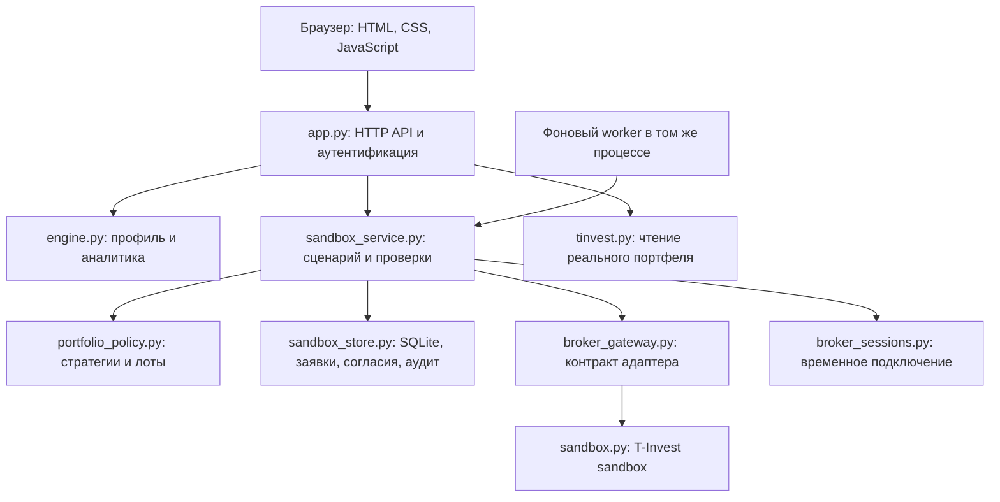
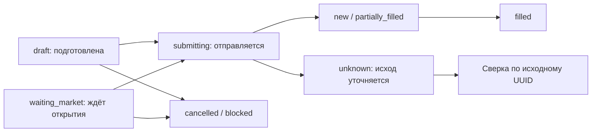

# ИИ-ИДУ: техническое описание и сценарий демо

Срез реализации: 17 октября 2026 года, версия 0.5.0. Основной код: [aeb8674](https://github.com/pafimov/ii-idu/commit/aeb86749e5d1ee55f2841717f19af26849c6e714). Документ описывает реализованное поведение; целевые доработки вынесены отдельно.

## 1. Что мы сделали

Рабочее веб-приложение с двумя основными сценариями:

1. Посмотреть свой инвестиционный портфель: подключить Т-Инвестиции для чтения, загрузить CSV или добавить позиции вручную; увидеть состав, концентрацию, изменение стоимости относительно указанной средней цены и расстояние до финансовой цели.
2. Пройти инвестиционный сценарий в песочнице Т-Инвестиций: подключить токен, получить отдельный виртуальный счёт с 10 млн ₽, выбрать цель и одну из четырёх стратегий, подтвердить конкретный план и увидеть результат заявок в портфеле.

Сайт доступен по адресу http://127.0.0.1:8765/#sandbox. Код, тесты и документация находятся в [GitHub](https://github.com/pafimov/ii-idu). Основной показ — раздел «Песочница»; существующий основной профиль и реальный портфель не подменяются данными этого раздела.

## 2. Пользовательский путь

### Вход и знакомство

Можно открыть демоаккаунт без регистрации либо создать аккаунт с именем, почтой и паролем. Почта служит логином; подтверждение письмом и восстановление пароля пока не реализованы. Демоаккаунт основного кабинета содержит пример портфеля с искусственными ценами. Его необходимо отличать от виртуального счёта, полученного от API брокера.

При регистрации из демо можно отдельно согласиться перенести основной профиль и портфель. Торговые разрешения и история sandbox-покупок таким копированием не переносятся.

### Подключение и первый запуск

Пользователь вводит sandbox-токен в разделе «Песочница». Токен — ключ доступа; у него нет собственного баланса. При подключении приложение запрашивает доступные счета, но само подключение деньги не начисляет.

Если счёт приложения ещё не создан, на первом «Показать покупки» backend вызывает создание виртуального счёта, затем пополнение на 10 млн ₽. Баланс проверяется по ответам брокера. Повторные расчёты и повторный ввод токена не добавляют очередные 10 млн.

### Цель и стратегия

Пользователь выбирает риск, название цели, желаемую сумму, срок и ежемесячный взнос. Состав зависит от выбранной стратегии. Сумма цели, срок и взнос используются в расчёте достижения цели; алгоритм не оптимизирует состав под требуемую доходность. Короткая форма песочницы отделена от полной анкеты инвестиционного профиля в основном кабинете.

### План и исполнение

«Показать покупки» готовит точные инструменты, количества, лоты, лимитные цены, комиссии и общий бюджет. Если бумага закрыта для торгов и проходит условия ожидания, она включается в отдельную группу того же плана. Покупка начинается после явного подтверждения: «Купить активы» или «Купить и ждать открытия».

Результат показывает каждую заявку: отправка, исполнение, ожидание, отмена или ошибка. Принятая заявка не считается купленной. Итог «Портфель собран» появляется только после исполнения всей серии и сверки количеств позиций со снимком брокера.

«Начать заново» создаёт другой виртуальный счёт с 10 млн ₽. Предыдущий счёт и история сохраняются. Пока есть ожидающие, активные или неизвестные по исходу заявки, новый старт блокируется. «Отменить оставшиеся покупки» прекращает будущую отправку и запускает отмену ещё неисполненных заявок; уже купленные активы сохраняются. Успех отмены на стороне брокера требует его подтверждения; запрос, уже допущенный к отправке, может успеть завершиться.

## 3. Архитектура

Использован модульный монолит: один Python-процесс, в котором ответственность разделена по модулям. Это сохраняет простой запуск и позволяет менять отдельные части без переписывания всей системы. Сейчас это не распределённый сервис и не набор микросервисов.

| Часть | Технология и назначение |
|---|---|
| Интерфейс | HTML/CSS и обычный JavaScript, без отдельной сборки. Переходы между разделами через URL-фрагменты, обновление данных через HTTP JSON API. |
| HTTP backend | Python 3.10+, стандартная библиотека, `ThreadingHTTPServer`. Маршрутизация, проверка владельца, аккаунты и API. |
| Доменная логика | `engine.py` и `portfolio_policy.py`: валидация, формулы, фиксированные стратегии, цены и целые лоты. |
| Прикладной сервис | `sandbox_service.py`: подготовка плана, согласие, допуск каждой отправки, ожидание, остановка и сверка. |
| Учёт | SQLite с транзакциями и WAL. `users`, `sessions`, `sandbox_states`, `sandbox_proposals`, `sandbox_consents`, `sandbox_orders`, `sandbox_actions`, `sandbox_audit`. |
| Брокер | Раздельные адаптеры: реальный портфель только читается; sandbox поддерживает виртуальные операции. |
| Фоновое выполнение | Поток внутри приложения. Проверяет статусы, обновляет снимок, продолжает только подтверждённую серию. |

Основные группы маршрутов: `/api/register`, `/api/login`, `/api/demo` — вход; `/api/broker/…` — реальный read-only контур; `/api/sandbox/connect`, `create`, `demo-preview`, `execute`, `refresh`, `stop`, `reset-demo` — песочница. `/api/sandbox/report` выгружает журнал владельца; `/api/health` сообщает версию и состояние worker.

## 4. Что происходит после «Показать покупки»

1. Backend проверяет пользователя, подключение и принадлежность счёта.
2. Получает снимок денег и позиций, каталог инструментов, цены и торговые ограничения.
3. Фиксирует версию конфигурации цели и стратегии. Текущая версия состава — `basket_version=2`; прежнее согласие на корзину без TMON не переносится на новую.
4. Для каждой позиции сравнивает текущую стоимость с целевой долей. Имеющиеся активы учитываются, поэтому на повторном расчёте уже купленные позиции не приобретаются заново целиком.
5. Округляет количество до целых лотов, рассчитывает лимитную цену с учётом шага цены инструмента. В текущей формуле покупки ориентир — цена × 1,003 с округлением вверх до шага; продажи — × 0,997 с округлением вниз. Это техническое правило расчёта, а не прогноз цены.
6. Вызывает расчёт стоимости у брокера, учитывает комиссию и буфер. Неизвестная обязательная комиссия блокирует отправку. Проверяются достаточность денег и ограничения долей.
7. Сохраняет неизменяемое в рамках согласия предложение: счёт, версии, исходный снимок, инструменты, направления, количества, лимиты, расходы и срок. SHA-256 fingerprint позволяет обнаружить изменение его содержимого; он не заменяет цифровую подпись клиента.

Для уже имеющейся позиции допустимое отклонение от целевой доли — 5 процентных пунктов. Если расчёт требует продаж, сначала предлагается серия продаж; дальнейшие покупки потребуют следующего расчёта и подтверждения. Смена стратегии существующего портфеля не обещает автоматический непрерывный цикл «продать и купить» за одну кнопку.

Количество рассчитывается с запасом на расходы, затем отдельно проверяются комиссия и буфер. Поэтому при целевом RUB=0 небольшой остаток рублей возможен: целые лоты, лимитные цены и расходы не позволяют гарантировать вложение до последней копейки.

## 5. Четыре стратегии

| Вариант | TMON | TGLD | TMOS | SBER | LKOH |
|---|---:|---:|---:|---:|---:|
| Осторожный | 85% | 15% | — | — | — |
| Умеренный | 60% | 20% | 10% | 5% | 5% |
| Сбалансированный | 40% | 20% | 25% | 10% | 5% |
| Динамичный | 10% | 20% | 35% | 20% | 15% |

TMON представляет денежный рынок, TGLD — золото, TMOS — российские акции; SBER и LKOH — отдельные позиции. TMON учитывается как фонд, а не как свободные деньги для оплаты других заявок. Названия риска — условные категории этих корзин, не рассчитанная волатильность и не результат индивидуального suitability. Состав фондов по отдельным бумагам сейчас не раскрывается; пересечение TMOS с отдельными акциями не устраняется.

Пример на 10 млн ₽ для сбалансированной стратегии: ориентиры 4 млн TMON, 2 млн TGLD, 2,5 млн TMOS, 1 млн SBER, 0,5 млн LKOH. Фактические суммы отличаются из-за лотов, лимитов, запаса и уже имеющихся активов.

## 6. Подтверждение и защита от повторной покупки

При подтверждении backend повторно проверяет предложение и сохраняет согласие, привязанное к владельцу, сессии и сроку. Для каждой операции заранее создаётся UUID и запись в журнале заявок. Точное поручение связывается с подтверждённым предложением.

Перед каждой отправкой заявки проверяются: актуальность согласия и правил, тот же счёт, отсутствие остановки, точность параметров заявки, состояние других заявок, доступность торговли, деньги на все оставшиеся покупки и допустимые расходы. Проверки выполняются на сервере; изменение формы или JavaScript не даёт права обойти их.

Основные состояния:

Схема показывает главные ветви, а не все переходы API. Повтор подтверждения не создаёт новую серию. Если после отправки потерян ответ, приложение не делает слепой повтор POST: сначала ищет результат по исходному UUID. Неизвестный исход блокирует дальнейшую отправку до сверки. Это защита от дублей на уровне приложения и идентификатора запроса, а не обещание абсолютного exactly-once при любых сбоях внешних систем.

## 7. Как работают покупки после открытия

Автоматическое ожидание разрешено только для покупки, которая уже в исходном плане отмечена закрытой. Backend требует точного совпадения инструмента и явного сочетания статусов: API доступен, лимитные заявки недоступны, инструмент не торгуется. Неизвестный статус или произвольная ошибка не превращаются в разрешение торговать позже.

Эта покупка заранее входит в бюджет и подтверждение. Она остаётся записью `waiting_market` в нашем приложении; брокерская заявка во время закрытия ещё не выставлена. Учётный резерв означает, что приложение проверяет деньги на все оставшиеся покупки. Он сам по себе не блокирует деньги у брокера и не защищает их от внешнего расходования.

Worker проверяет доступность ожидающих операций с интервалом не меньше примерно 20 секунд между повторными проверками конкретной заявки. Доступные покупки проходят раньше закрытой, поэтому ожидание золота не мешает покупке TMON и акций.

После открытия заново проверяются деньги, ограничения, расходы, согласие и точные параметры. Затем используется прежний UUID, количество и лимит. Автоматически повышать цену или увеличивать расходы система не будет. Открытие торгов позволяет отправить заявку, но не гарантирует её исполнение по фиксированному лимиту.

Срок ожидания — минимум из 7 суток, срока текущей сессии приложения и правил стратегии; точный срок показан пользователю. Это срок конкретного поручения. Искусственного idle-таймера у sandbox-подключения нет. Сервер и подключение должны оставаться активными. После перезапуска токен вводится снова; учёт сохранён. Для продолжения worker требуется также обновление счёта (`POST /api/sandbox/refresh`), которое привязывает его к новому подключению, и успешная сверка при ещё действующем согласии. Один ввод токена не возобновляет очередь автоматически. Полный пользовательский путь восстановления после перезапуска пока не завершён: при частично исполненной серии кнопка обновления может отсутствовать. Для демонстрации непрерывного ожидания сервер следует оставить запущенным. Смена входа не переносит прежнее согласие в новую сессию.

## 8. Аналитика: что рассчитывается

В основном кабинете стоимость позиции равна количеству × цене. Из неё рассчитываются доли классов активов и секторов, крупнейшая позиция и концентрация. Изменение относительно средней цены — ценовой результат по имеющимся входным данным, а не полная доходность с учётом всех денежных потоков. Для брокерских облигаций отдельно учитывается НКД. Упрощённая категория риска основного кабинета использует долю акций/фондов и концентрацию; она не заменяет риск-модель и может грубо классифицировать разные типы фондов.

В песочнице показываются фактические позиции и стоимость по снимку API, доли, рублёвый остаток и сумма на ожидающие покупки. Итоговая сверка сопоставляет UID и количества с исходным портфелем и подтверждёнными исполнениями. Полноценный отдельный денежный settlement ledger не реализован; деньги отображаются из брокерского снимка.

Расчёт цели прозрачен:

`сумма без роста = текущая стоимость + ежемесячный взнос × 12 × число лет`

`разрыв = max(0, цель − сумма без роста)`

Например, 10 млн сейчас и 50 тыс. в месяц за 5 лет дают 13 млн без изменения цен; до цели 20 млн остаётся 7 млн. Это арифметический сценарий без доходности, инфляции, налогов и будущих расходов. Указанный ежемесячный взнос не включает автоматические переводы денег. Стресс-сценарии основного кабинета также используют заданные коэффициенты падения, а не прогноз рынка.

## 9. Два контура и данные

Реальный адаптер `tinvest.py` предоставляет чтение. В нём нет функций отправки или отмены реальных заявок. Sandbox-адаптер обращается к фиксированному адресу песочницы; подменить его адрес пользовательским запросом или включить production-переключатель нельзя.

Профили, снимки, версии, предложения, согласия и журнал операций сохраняются в SQLite. Токены находятся только в памяти процесса, отдельно по владельцу, сессии и контуру, и не включаются в отчёт или GitHub. После отключения или перезапуска доступ нужно восстановить. Для реального read-only подключения сохраняются отдельные таймауты; у sandbox idle/hard TTL отключены.

Пароли хешируются PBKDF2 с солью. Сессионная cookie имеет HttpOnly и SameSite=Strict; изменяющие запросы проходят проверку Origin/Host. Текущий сервер привязан к 127.0.0.1. База не зашифрована; публичный HTTPS-контур и промышленное управление секретами ещё предстоит реализовать.

Языковая модель пока не подключена. Выбор долей, проверки и отправка детерминированы, а объяснения строятся из расчётов. В целевой архитектуре AI может помогать с диалогом и объяснением, но торговые полномочия, риск-проверки и авторизация остаются отдельным контролируемым контуром.

## 10. Что доказано проверками

Последний полный прогон: **154 автоматических теста, OK, 17,996 с**, плюс проверка синтаксиса трёх JS-файлов. Проверены изоляция владельцев, версии, расходы, UUID, неизвестный исход, отмена, сроки, резерв, ожидание закрытого инструмента и запрет распространить это согласие на другие покупки.

В отдельном фактическом прогоне через API песочницы 17 октября получены четыре исполнения и четыре сверенные позиции: TMON, TMOS, SBER, LKOH. TGLD оставался в ожидании. После проверки оставшаяся тестовая покупка была отменена; исполненные позиции сохранились. Будущее открытие TGLD фактически не наблюдалось: отправка после открытия с тем же UUID проверена автоматическим тестом с моделируемыми ответами.

Это виртуальные исполнения брокерского эмулятора. Официальное описание Т-Банка уточняет, что песочница использует биржевую информацию, но не выводит поручения на биржу: [FAQ песочницы](https://developer.tbank.ru/invest/intro/developer/sandbox/faq_sandbox). Успешный sandbox-проход не доказывает реальную ликвидность, доходность, удержание клиентов или готовность полного production-контура.

## 11. Как развивается целевая архитектура

Разделение policy → service → gateway → adapter уже позволяет отдельно заменить интеграцию, хранение и фонового исполнителя. На текущем этапе единый процесс уменьшает сложность сборки, отладки и передачи кода. Извлечение сервисов само по себе не сделает исполнение надёжнее: сначала нужны контракты данных и полномочий.

Для внешнего массового продукта остаются:

- Вход через целевой identity-контур и делегированное согласие вместо копирования токена; роли сотрудников и общая остановка.
- Согласованный специальный production-контракт с Т-Инвестициями: права, события, источник времени актуальности, лимиты, SLA и ответственность.
- Утверждённые профиль, допустимые инструменты и инвестиционные ограничения. Короткий выбор риска песочницы не заменяет этот процесс.
- Отдельный устойчивый worker, блокировки выполнения между экземплярами, восстановление после сбоев, мониторинг и уведомления.
- Управляемая БД, миграции, защищённое хранение секретов и аудита, резервирование и проверка восстановления.
- Приёмка на реальном контуре, нагрузочные и эксплуатационные проверки, затем измерение продуктовых результатов.

Это план развития, не утверждённые внутренние API или уже полученные согласования. Правовая модель продукта и реальные торговые полномочия требуют отдельных решений. Полная сверка с 13 FR и 8 NFR находится в [REQUIREMENTS.md](REQUIREMENTS.md); наличие 154 тестов не означает выполнение всех 66 вариантов исходной RTM.

## 12. Порядок показа и ответы на вопросы

| Шаг | Что показать | Что сказать |
|---|---|---|
| 1 | Раздел «Песочница» | «Пользователь начинает с цели и понятного выбора риска». |
| 2 | Переключить риск, показать доли | «Состав меняется сразу; видна целевая доля фонда денежного рынка TMON». |
| 3 | Цель и взнос | «Сразу видно, хватает ли собственных вложений без обещаний доходности». |
| 4 | «Показать покупки» | «Проценты превращаются в конкретные лоты, лимиты и расходы». |
| 5 | Группы доступных и закрытых | «Закрытые бумаги входят в тот же план; после подтверждения система ждёт открытия». |
| 6 | Подтвердить sandbox-серию | «Backend ещё раз проверяет согласие, деньги и параметры каждой операции». |
| 7 | Статусы и портфель | «Показываем подтверждённые исполнения; ожидание не выдаём за собранный портфель». |
| 8 | История покупок | «Можно проследить, что подтвердили, что отправили и что ответил брокер». |

Для чистого полного прохода использовать «Начать заново», если незавершённых заявок нет. Для показа докупки — оставить текущий счёт: старые позиции войдут в расчёт. Не обещать, что закрытый инструмент откроется во время выступления; сама очередь — часть рабочего сценария. Кнопку отмены в ходе показа нажимать только если действительно нужно отменить все оставшиеся неисполненные покупки.

**«Где здесь AI?»** Сейчас реализованы инфраструктура инвестиционного сценария, правила и объяснения. Генеративный помощник — следующий слой; модель не должна самостоятельно выдавать торговое разрешение.

**«Цель влияет на состав?»** В этой версии пользователь выбирает одну из четырёх корзин. Цель, срок и взносы влияют на арифметику достижения цели; автоматического подбора требуемой доходности нет.

**«Почему деньги ещё в рублях?»** Часть может ждать закрытую покупку, остальное — остаток лотов и запас расходов. Учётный резерв показывается отдельно; TMON уже является купленной позицией.

**«Можно ли завтра включить реальные покупки?»** Потребуется отдельный production-контур и приёмка. В текущем реальном адаптере есть только чтение, переключателя для реальной торговли нет.

**«Что главное сделано?»** Собран и проверен связный путь: цель → стратегия → конкретное согласие → брокерская операция → сверка → понятный результат. Код разделён так, чтобы развивать этот путь дальше.

## Основания

- Код версии 0.5.0, [архитектура](ARCHITECTURE.md), [проверки](VERIFICATION.md), [путь показа](DEMO.md), [карта требований](REQUIREMENTS.md).
- Т-Банк: [методы sandbox](https://developer.tbank.ru/invest/intro/developer/sandbox/methods), [состав SandboxService](https://developer.tbank.ru/invest/api/sandbox-service), [расчёт стоимости заявки](https://developer.tbank.ru/invest/api/sandbox-service-get-sandbox-order-price), [FAQ](https://developer.tbank.ru/invest/intro/developer/sandbox/faq_sandbox). Проверено по официальным материалам 17.10.2026; описания наших правил ожидания и резервирования основаны на коде приложения, а не приписываются брокеру.
